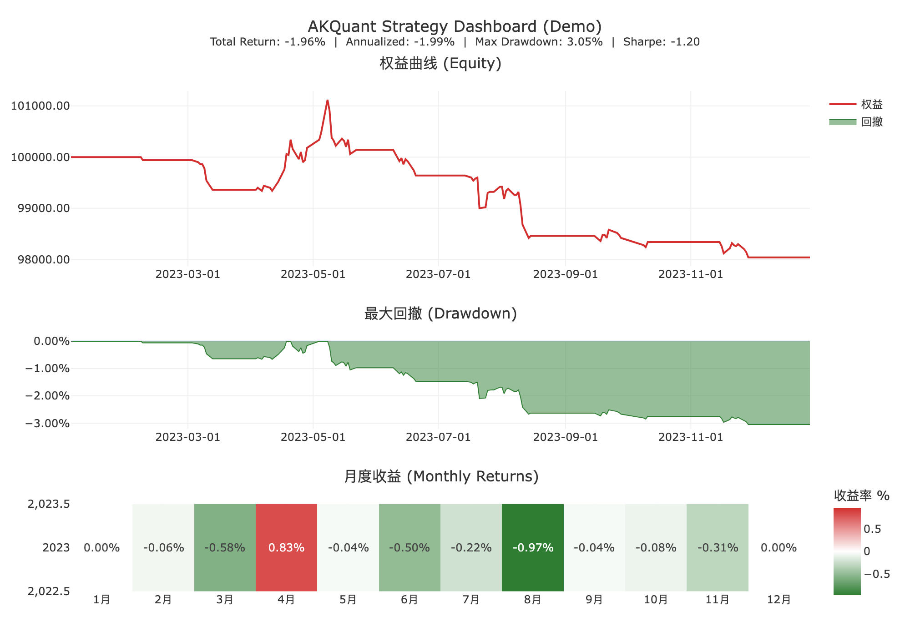

<p align="center">
  
</p>

<p align="center">
    <a href="https://pypi.org/project/akquant/">
        
    </a>
    <a href="https://pypi.org/project/akquant/">
        
    </a>
    <a href="LICENSE">
        
    </a>
    <a href="https://github.com/akfamily/akshare">
        
    </a>
    <a href="https://pepy.tech/projects/akquant">
        
    </a>
</p>

<!-- mcp-name: io.github.akfamily/akquant -->

**AKQuant** 是一个回测与实盘一体的量化交易框架：核心引擎用 **Rust** 编写，策略用 **Python** 编写，覆盖股票、期货、期权等品种。

## 核心特性

*   **Rust 引擎，Python 策略**：事件驱动的撮合、结算与风控在 Rust 中完成，NumPy 数组可零拷贝导入引擎；策略侧只需继承 `Strategy` 并实现 `on_bar` 等回调。实际速度取决于策略逻辑、数据规模与回调频率。
*   **回测与实盘同一套策略**：`run_backtest` 回测，`run_live` 做仿真或实盘；内置 CTP 期货接口，其他柜台可以注册自定义券商接口接入。
*   **贴近 A 股规则**：T+1、涨跌停、佣金/印花税/过户费、期货保证金、期权希腊值，以及中国时区内置的交易所日历。
*   **指标与因子**：`akquant.talib` 提供 104 个 TA-Lib 兼容指标（`python`/`rust` 双后端）；`self.I()` 声明式指标支持多周期；Polars 驱动的因子表达式引擎支持 `Rank(Ts_Mean(Close, 5))` 这类 Alpha101 风格公式。
*   **订单与风控**：市价、限价、止损单，OCO 与 Bracket 组合订单，下单前的风控检查。
*   **参数优化与机器学习**：多进程网格搜索；内置 Walk-forward（滚动训练）框架，可接入 PyTorch、scikit-learn 模型。
*   **分析与可视化**：一行代码生成交互式 HTML 报告，另有 K 线复盘、收益归因、暴露与容量分析。
*   **AI 助手（MCP）**：自带 MCP 服务，可在 AI 助手中用自然语言写策略、跑回测，已上架 [MCP 官方注册表](https://registry.modelcontextprotocol.io/v0.1/servers?search=io.github.akfamily/akquant)（`io.github.akfamily/akquant`）。

**[阅读完整文档](https://akquant.akfamily.xyz/)** | **[English Documentation](https://akquant.akfamily.xyz/en/)**

## 安装

**AKQuant** 已发布至 PyPI，支持 Python 3.10 及以上版本，无需安装 Rust 环境。

```bash
pip install akquant
```

## 快速开始

下面的示例用 AKShare 获取浦发银行日线，阳线买入、阴线卖出：

```python
import akquant as aq
import akshare as ak
from akquant import Strategy

# 1. 准备数据
# 使用 akshare 获取 A 股历史数据 (需安装: pip install akshare)
df = ak.stock_zh_a_daily(symbol="sh600000", start_date="20250212", end_date="20260212")


class MyStrategy(Strategy):
    def on_bar(self, bar):
        # 简单策略示例:
        # 当收盘价 > 开盘价 (阳线) -> 买入
        # 当收盘价 < 开盘价 (阴线) -> 卖出

        # 获取当前持仓
        current_pos = self.get_position(bar.symbol)

        if current_pos == 0 and bar.close > bar.open:
            self.buy(symbol=bar.symbol, quantity=100)
            print(f"[{bar.timestamp_iso}] Buy 100 at {bar.close:.2f}")  # UTC ISO 8601

        elif current_pos > 0 and bar.close < bar.open:
            self.close_position(symbol=bar.symbol)
            print(f"[{bar.timestamp_iso}] Sell 100 at {bar.close:.2f}")  # UTC ISO 8601


# 运行回测
result = aq.run_backtest(
    data=df,
    strategy=MyStrategy,
    initial_cash=100000.0,
    symbols="sh600000",
    broker_profile="cn_stock_t1_low_fee",  # A 股佣金/印花税/过户费、T+1、一手 100 股
)

# 打印回测结果
print("\n=== Backtest Result ===")
print(result)

# 生成最小基准对比报告
benchmark_returns = (
    df.set_index("date")["close"].pct_change().fillna(0.0).rename("SIMPLE_BENCH")
)
result.viz.report(
    filename="quickstart_report.html",
    show=False,
    benchmark=benchmark_returns,
)
```

调用 `result.viz.report(..., benchmark=...)` 后，报告会新增“基准对比 (Benchmark Comparison)”区块，展示策略/基准/超额累计收益曲线，以及累计超额收益、年化超额收益、跟踪误差、信息比率、Beta、Alpha 等相对指标。

> **注意：`run_backtest` 默认不计交易成本、不开 T+1。** 不传 `broker_profile` 也不传费率时，佣金、印花税、过户费都是 0，可以当日买卖，最小交易单位是 1 股——这样得到的是理想化的结果，换手越高越偏乐观。A 股回测请像上面这样传 `broker_profile`（内置 `cn_stock_standard`、`cn_stock_t1_low_fee`、`cn_stock_sim_high_slippage`），或者显式传 `commission_rate`、`stamp_tax_rate`、`transfer_fee_rate`、`min_commission`、`t_plus_one=True`、`lot_size=100`。模板的印花税按 2023-08-28 起的现行税率 0.05% 计，回测此前的行情请显式传 `stamp_tax_rate=0.001`。

**运行结果示例（节选）：**

```text
=== Backtest Result ===
BacktestResult:
                                            Value
start_time              2025-02-12 15:00:00+08:00
end_time                2026-02-12 15:00:00+08:00
total_bars                                    249
closed_trade_count                           62.0
initial_market_value                     100000.0
end_market_value                     99379.212386
total_return_pct                        -0.620788
annualized_return                       -0.006208
total_commission                       409.903014
max_drawdown_pct                         0.623393
win_rate                                22.580645
sharpe_ratio                            -2.574886
profit_factor                            0.720871
...
```

## 在 AI 助手中使用（MCP）

先[安装 uv](https://docs.astral.sh/uv/getting-started/installation/)，然后在 WorkBuddy、DeepSeek Harness、Codex、Cursor、Claude 等 AI 助手中说一句话即可：

> 安装 AKShare 和 AKQuant 的官方 MCP，项目目录用 /path/to/akquant-demo，运行一个示例策略并报告结果

助手会自己配置好两个服务，再下载数据、编写策略、运行回测并解读结果，**不需要事先安装 AKQuant**。接入后可以直接说“用平安银行近三年的日线跑一个均线交叉策略，报告收益和最大回撤”。

需要手动配置时，`--root` 是项目目录（请先建好），策略和数据文件都放在里面：

```bash
claude mcp add akquant -- uvx --from "akquant[mcp]" akquant-mcp --root /path/to/akquant-demo
codex mcp add akquant -- uvx --from "akquant[mcp]" akquant-mcp --root /path/to/akquant-demo
```

使用 JSON 配置的客户端：

```json
{
  "mcpServers": {
    "akquant": {
      "command": "uvx",
      "args": ["--from", "akquant[mcp]", "akquant-mcp", "--root", "/path/to/akquant-demo"]
    }
  }
}
```

其余客户端的配置、工具清单与注意事项见 [MCP 服务文档](https://akquant.akfamily.xyz/guide/mcp/)。和 [AKTools](https://github.com/akfamily/aktools)（AKShare 的官方 MCP）一起接入，助手可以自己查数据。

## 组合订单（OCO / Bracket）

*   `place_oco(first_order_id, second_order_id, group_id=None)`：将两个订单绑定为 OCO，任一成交后自动撤销另一单。
*   `place_bracket(symbol, quantity, entry_price=None, stop_trigger_price=None, take_profit_price=None, ...)`：一次性提交 Bracket 结构；进场成交后自动挂出止损/止盈，并在双退出单场景下自动绑定 OCO。

```python
from akquant import OrderStatus, Strategy

class BracketHelperStrategy(Strategy):
    def __init__(self):
        self.entry_order_id = ""

    def on_bar(self, bar):
        if self.get_position(bar.symbol) > 0 or self.entry_order_id:
            return

        self.entry_order_id = self.place_bracket(
            symbol=bar.symbol,
            quantity=100,
            stop_trigger_price=bar.close * 0.98,
            take_profit_price=bar.close * 1.04,
            entry_tag="entry",
            stop_tag="stop",
            take_profit_tag="take",
        )

    def on_order(self, order):
        if order.id == self.entry_order_id and order.status in (
            OrderStatus.Cancelled,
            OrderStatus.Rejected,
        ):
            self.entry_order_id = ""
```

可直接运行完整示例：

```bash
python examples/06_complex_orders.py
```

## 流式回测

如果你希望在回测执行过程中实时消费事件，可直接使用 `run_backtest` 并传入 `on_event`：

```python
def on_event(event):
    if event["event_type"] == "finished":
        payload = event["payload"]
        print("status:", payload.get("status"))
        print("callback_error_count:", payload.get("callback_error_count"))

result = aq.run_backtest(
    data=df,
    strategy=MyStrategy,
    symbols="sh600000",
    on_event=on_event,
    show_progress=False,
    stream_progress_interval=10,
    stream_equity_interval=10,
    stream_batch_size=32,
    stream_max_buffer=256,
    stream_error_mode="continue",
)
```

`on_event` 为可选参数：不传时保持传统阻塞语义，传入时可实时消费事件。

关键参数：

*   `stream_progress_interval` / `stream_equity_interval`: 进度与权益事件采样间隔
*   `stream_batch_size` / `stream_max_buffer`: 缓冲与批量刷新控制
*   `stream_error_mode`: 回调异常策略，支持 `"continue"` 与 `"fail_fast"`

## 可视化与分析

`result.viz.report()` 生成基于 Plotly 的交互式 HTML 报告，包含权益曲线、回撤分析、月度热力图等：

```python
# 生成交互式 HTML 报告，自动在浏览器中打开
result.viz.report(
    show=True,
    compact_currency=True,  # 金额列按 K/M/B 紧凑显示（默认 True）
)

# 如果你希望金额列保留原始数值精度（不缩写），可关闭：
result.viz.report(
    show=False,
    filename="report_raw_amount.html",
    compact_currency=False,
)
```

你也可以直接复用结构化分析结果做二次研究：

```python
exposure = result.exposure_df()             # 暴露分解（净暴露/总暴露/杠杆）
attr_by_symbol = result.attribution_df(by="symbol")
attr_by_tag = result.attribution_df(by="tag")
capacity = result.capacity_df()             # 容量代理（成交率/换手等）
orders_by_strategy = result.orders_by_strategy()         # 按策略归属聚合订单
executions_by_strategy = result.executions_by_strategy() # 按策略归属聚合成交
```

<p align="center">
  
</p>

## 文档索引

*   **[安装指南](https://akquant.akfamily.xyz/start/installation/)**：详细的安装步骤（含源码编译）。
*   **[快速入门](https://akquant.akfamily.xyz/start/quickstart/)**：更多示例与基础用法。
*   **[策略编写](https://akquant.akfamily.xyz/guide/strategy/)**：回调、下单接口与声明式指标。
*   **[实盘上手](https://akquant.akfamily.xyz/advanced/live_functional_quickstart/)**：`run_live` 的仿真与实盘模式，另见[券商能力矩阵](https://akquant.akfamily.xyz/advanced/broker_capability_matrix/)。
*   **[因子表达式](https://akquant.akfamily.xyz/guide/factor/)** 与 **[参数优化](https://akquant.akfamily.xyz/guide/optimization/)**。
*   **[机器学习指南](https://akquant.akfamily.xyz/advanced/ml/)**：使用内置框架做滚动训练。
*   **[可视化](https://akquant.akfamily.xyz/guide/visualization/)**：报告、K 线复盘与指标绘制。
*   **[MCP 服务](https://akquant.akfamily.xyz/guide/mcp/)**：在 AI 助手中查 API、写策略、跑回测。
*   **[API 参考](https://akquant.akfamily.xyz/reference/api/)**：类与函数文档。

## 开发与测试

回测引擎的正确性由 Rust 与 Python 两侧的单元测试，以及黄金测试（Golden Tests）保证：后者用合成数据验证 T+1、涨跌停、保证金、期权希腊值等关键规则，并与锁定的基线结果比对。

从源码构建、运行测试和提交代码的步骤见[贡献指南](https://github.com/akfamily/akquant/blob/main/CONTRIBUTING.md)。

## 引用

如需在论文或报告中引用本项目，可使用以下 BibTeX：

```bibtex
@misc{akquant,
    author = {Albert King and Yaojie Zhang and Chao Liang},
    title = {AKQuant},
    year = {2026},
    publisher = {GitHub},
    journal = {GitHub repository},
    howpublished = {\url{https://github.com/akfamily/akquant}},
}
```

## 许可证

[MIT License](LICENSE)
